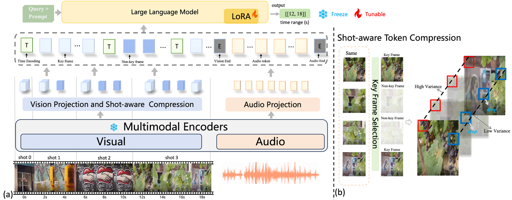

# SMART: Shot-Aware Multimodal Video Moment Retrieval with Audio-Enhanced MLLM

[Paper](https://ieeexplore.ieee.org/abstract/document/11655331) · [PDF](https://arxiv.org/pdf/2511.14143)

**An Yu, Weiheng Lu, Jian Li, Zhenfei Zhang, Yunhang Shen, Felix X.-F. Ye, and Ming-Ching Chang**

SMART combines audio information with shot-aware token compression for video moment
retrieval. This release contains the **QVHighlights** training and inference pipeline,
built on Mr. BLIP and LAVIS, with BLIP-2 / Flan-T5-XL and a BEATs audio encoder.

<p align="center">
  
</p>

## Repository layout

```text
configs/qvhighlights/    Main training, validation and test inference settings
lavis_1019/             SMART implementation and its required LAVIS modules
scripts/                Portable training and evaluation launchers
train.py                Training entrypoint
evaluate.py             Inference / evaluation entrypoint
data/qvhighlights/      Prepared annotations and shot boundaries
checkpoints/            Local pretrained / fine-tuned weights (ignored by Git)
standalone_eval/        Upstream QVHighlights evaluation utilities
tests/                  CPU release checks
```

The internal Python package name `lavis_1019` is retained for compatibility.
Only the SMART model (`blip2_mr`), QVHighlights builder (`qvh`), and moment retrieval
task are registered. The train and evaluation paths are:

```text
QVHighlights video + audio + shot boundaries
  → EVA-CLIP → Q-Former → visual projection → full STC
  + BEATs → 150-token average pooling → audio projection
  → timestamped multimodal prompt → Flan-T5-XL with LoRA
  → training loss / generated moment timestamps
```

## Installation

The reference environment uses Linux, Python 3.8 and PyTorch 2.4.1. A CUDA GPU
is needed for training and model inference. Install FFmpeg with your
system package manager, then create the environment:

```bash
conda create -n smart python=3.8 -y
conda activate smart
# Example for CUDA 12.1; choose the matching PyTorch build for your system.
pip install torch==2.4.1 torchvision==0.19.1 torchaudio==2.4.1 --index-url https://download.pytorch.org/whl/cu121
pip install -r requirements.txt
pip install --no-deps -e .
```

Run the following commands from the repository root. Both the shell launchers and
Python entrypoints locate the checkout automatically when called from another
directory. Configuration files, videos, local model weights, resume checkpoints,
debug files and output directories use paths relative to the repository root.

## Prepare QVHighlights

Download the videos from the [QVHighlights / Moment-DETR project](https://github.com/jayleicn/moment_detr).
SMART reads **video clips with their audio tracks**, rather than precomputed CLIP
features. Place the clips in `data/qvhighlights/videos/`, named `<video_id>.mp4`:

```text
data/qvhighlights/
├── train.json
├── val.json
├── test_dummy.json
├── scene_boundaries.json
└── videos/
    └── NUsG9BgSes0_210.0_360.0.mp4
```

The supplied annotations contain **7,218 train, 1,550 validation and 1,542 test
queries**.
See [data notes](data/qvhighlights/README.md) for the annotation schema and boundary
coverage. Test windows are placeholders because the test ground truth is hidden.

To use a different video directory, give its path relative to the repository root:

```bash
bash scripts/train_qvhighlights.sh --options datasets.qvh.build_info.videos.storage=../datasets/qvhighlights/videos
```

Alternatively, edit [dataset paths](lavis_1019/configs/datasets/qvh/defaults.yaml).
Relative dataset paths resolve from the repository root.

## Prepare models

Download the **pretrained BEATs_iter3** model from the
[official BEATs repository](https://github.com/microsoft/unilm/tree/master/beats)
and save it as `checkpoints/BEATs_iter3.pt`. Use the pretrained Iter3 model from
the table, rather than one of its AudioSet fine-tuned variants.

Flan-T5-XL, BERT, EVA-CLIP and the pretrained BLIP-2 weights are downloaded by the
model loaders on first use. For local copies, set `model.t5_model`,
`model.pretrained`, and `model.beats_checkpoint` through `--options`; set
`SMART_BERT_MODEL` to the local BERT directory. EVA-CLIP uses the standard Torch
Hub checkpoint cache. See [checkpoint notes](checkpoints/README.md).

Fine-tuned SMART weights are **not included** in this source release. Train a
checkpoint with the next command, or supply an existing compatible SMART
checkpoint for evaluation. There is no hosted SMART checkpoint download in this
release.

## Train

```bash
NPROC_PER_NODE=8 bash scripts/train_qvhighlights.sh
```

[The main config](configs/qvhighlights/train.yaml) uses 80 sampled frames, 32
keyframes, full STC, audio enabled, a per-GPU batch size of 1, gradient accumulation
of 4, and up to 50 epochs. Training validates on `val`; it does not score the hidden
test split. Weights & Biases logging is disabled by default.

| Training setting | Value |
| --- | --- |
| GPUs / batch per GPU / gradient accumulation | 8 / 1 / 4 |
| Optimizer | AdamW, betas `(0.9, 0.999)`, epsilon `1e-8`, weight decay `0.05` |
| Learning rate | Initial `3e-4`, minimum `0`, linear warmup from `1e-8` for 2,255 steps, cosine schedule |
| Epochs / random seed | 50 / 42 |
| Video input | 80 frames, 224 x 224 pixels |
| Q-Former queries / selected keyframes | 32 / 32 |
| LoRA | Rank 8, alpha 8, dropout 0.05 |
| Precision / data workers | AMP enabled, vision precision `fp16`, 8 workers per process |

`NPROC_PER_NODE` controls the number of local GPU processes. For a smaller machine:

```bash
CUDA_VISIBLE_DEVICES=0 NPROC_PER_NODE=1 bash scripts/train_qvhighlights.sh
```

Reducing GPU count changes the effective batch size unless gradient accumulation
is adjusted. Frame count and memory settings can also be overridden, but changing
them changes the experiment. The 80-frame model requires substantial GPU memory;
this release does not specify a measured minimum.

Training outputs are saved under
`output/qvhighlights/train/qvhighlights_train-*/`, including
`checkpoint_best.pth`, selected by validation performance. The entire output
directory is ignored by Git.

## Validate

```bash
NPROC_PER_NODE=8 bash scripts/eval_qvhighlights.sh --options model.finetuned=output/qvhighlights/train/qvhighlights_train-1/checkpoint_best.pth
```

Alternatively, place the checkpoint at `checkpoints/smart_qvhighlights.pth` and
run the script without `--options`. The default evaluation split is **validation**,
using its real annotations. Decoding uses 5 beams, minimum length 8 and a maximum
of 50 new tokens. Predictions, retrieval metrics, and efficiency logs are written
under `output/qvhighlights/eval/`.

## Test inference

```bash
SPLIT=test NPROC_PER_NODE=8 bash scripts/eval_qvhighlights.sh --options model.finetuned=output/qvhighlights/train/qvhighlights_train-1/checkpoint_best.pth
```

Test inference saves predictions under `output/qvhighlights/test/` and
**disables metric computation** against the dummy windows. The saved files use
this repository's internal prediction format. Official test scoring requires
conversion to the benchmark submission format and the dataset's evaluation
service; local dummy-window scores are not benchmark results. See the
[official submission instructions](https://github.com/jayleicn/moment_detr/tree/main/standalone_eval).
SMART retrieves moments and does not train a separate highlight-detection head.

## Checks

```bash
python -m unittest discover -s tests -v
python train.py --help
python evaluate.py --help
```

These CPU checks cover the SMART/QVHighlights registry, main experiment settings,
shot boundaries, STC frame-token selection, audio pooling, test prediction output
handling and repository-relative paths when launched from another directory.
They do not reproduce full training or the paper's metrics.

## Citation

```bibtex
@article{yu2026smart,
  title={Smart: Shot-aware multimodal video moment retrieval with audio-enhanced mllm},
  author={Yu, An and Lu, Weiheng and Li, Jian and Zhang, Zhenfei and Shen, Yunhang and Ye, Felix X-F and Chang, Ming-Ching},
  journal={IEEE Transactions on Multimedia},
  year={2026},
  publisher={IEEE}
}
```

## Acknowledgments and license

This implementation builds on [Mr. BLIP](https://github.com/sudo-Boris/mr-Blip),
[LAVIS / BLIP-2](https://github.com/salesforce/LAVIS),
[BEATs](https://github.com/microsoft/unilm/tree/master/beats), and
[QVHighlights / Moment-DETR](https://github.com/jayleicn/moment_detr).
The original [BSD-3-Clause license](LICENSE.txt) and source copyright notices are
preserved. See [third-party notices](THIRD_PARTY_NOTICES.md) for component licenses.
